# JobScout 🔍

Ein lokales Bewerbungs-Cockpit: JobScout sammelt Stellenanzeigen aus mehreren
Job-APIs, bewertet sie per regelbasiertem Scoring gegen ein persönliches Profil
und begleitet den ganzen Bewerbungsprozess – vom Lebenslauf über Zertifikate und
Zeugnisse bis zur fertigen Bewerbungsmappe als PDF.

Entstanden als persönliches Projekt während meiner Weiterbildung zum
**Digital Sales Manager**. Die Scoring-Logik folgt demselben Prinzip wie Lead
Scoring in CRM-Systemen (HubSpot, Salesforce), nur angewendet auf
Stellenanzeigen statt Leads.

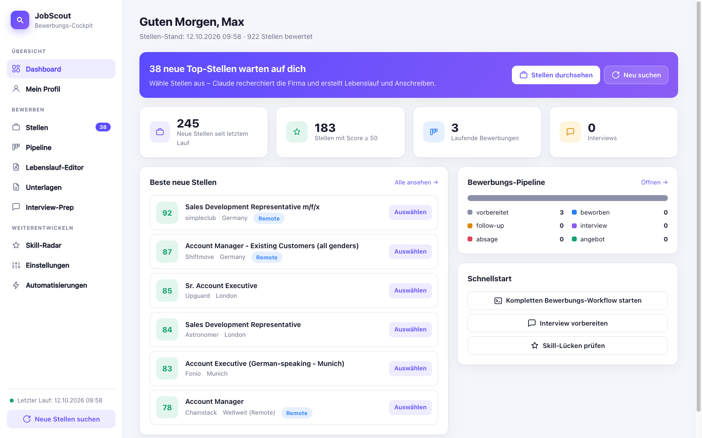

> Alle Screenshots zeigen erfundene Demo-Daten („Max Mustermann“).

---

## Inhalt

- [Schnellstart](#schnellstart)
- [Funktionen im Überblick](#funktionen-im-überblick)
- [Cockpit – alle Seiten im Detail](#cockpit--alle-seiten-im-detail)
- [Kommandozeile & Automatisierung](#kommandozeile--automatisierung)
- [Dateien & Datenschutz](#dateien--datenschutz)
- [Architektur & Tech-Stack](#architektur--tech-stack)

---

## Schnellstart

```bash
pip3 install requests            # einzige Python-Abhängigkeit (nur für den Scraper)
brew install poppler             # pdftotext, pdftoppm, pdfunite für PDF-Import/-Mappe
python3 jobscout_app.py          # Cockpit starten → http://127.0.0.1:8765
```

Alternativ per Doppelklick auf `run_cockpit.command` oder über die Desktop-App
(`start_cockpit.sh` startet den Server bei Bedarf und öffnet den Browser).

**Optional:**

| Werkzeug | Wofür |
|---|---|
| [Claude Code](https://claude.com/claude-code) (`claude`) | PDF-Import, Zertifikate/Zeugnisse auslesen, Bewerbungs- und Interview-Workflows |
| Google Chrome | PDF-Export des Lebenslaufs und der Bewerbungsmappe (headless) |
| Microsoft Word | originalgetreue Umwandlung von DOCX-Anschreiben in der Mappe (sonst `textutil`) |
| Adzuna-API-Keys in `.env` (`ADZUNA_APP_ID`, `ADZUNA_APP_KEY`) | vierte Jobquelle – ohne Keys wird sie übersprungen |

---

## Funktionen im Überblick

**Stellen finden & bewerten**
- 4 Datenquellen: Bundesagentur für Arbeit (offizielle Jobsuche-API), Adzuna,
  Arbeitnow, Himalayas – plus optional LinkedIn über eine Claude-Brücke
- Regelbasiertes Scoring (0–100) mit Titel- und Text-Keywords, Malus,
  Ausschlüssen, Remote-/Lokal-Bonus und Frische-Bonus
- Verneinungs-Erkennung: „keine Kaltakquise“ wird zum Bonus statt zum Malus
- Wortgrenzen-Matching: „KI“ trifft nicht „Logistik“
- NEU-Erkennung seit dem letzten Lauf (SQLite), macOS-Mitteilung ab Wunsch-Score
- HTML-Report mit Score-Ampel und Begründung je Stelle, CSV-Export

**Bewerben**
- Stellen im Cockpit auswählen → Claude recherchiert die Firma und schreibt
  Lebenslauf und Anschreiben (Claude Code im Terminal)
- Kanban-Pipeline mit Drag & Drop und Follow-up-Erinnerungen
- Interview-Prep: Firmenrecherche, 10 wahrscheinliche Fragen mit
  Antwortgerüst, Rückfragen, Checkliste

**Profil & Unterlagen**
- Profilseite als zentrale Quelle für alle persönlichen Daten
- Lebenslauf-Editor mit Live-Vorschau, ATS-Check und PDF-Export
- PDF-Import: bestehende Lebensläufe (auch LinkedIn-Export) werden von
  Claude strukturiert übernommen
- Zertifikate, Zeugnisse und Nachweise mit Datei-Upload, Miniaturansicht und
  automatischer Auswertung
- Bewerbungsmappe auf Knopfdruck: Deckblatt + Dokumente als ein PDF

**Weiterentwickeln**
- Skill-Radar: Marktnachfrage je Skill vs. eigenes Profil, Lücken und Trend
- Skill-Editor für eigene Skills samt Synonymen
- Skill-Gap-Analyse mit Kurssuche über Claude

---

## Cockpit – alle Seiten im Detail

Das Cockpit (`jobscout_app.py`) ist eine lokale Weboberfläche ohne
Zusatzpakete. Es lauscht nur auf `127.0.0.1` und nimmt schreibende Anfragen
nur mit dem Header `X-JobScout: 1` an (Schutz gegen fremde Webseiten).

### Dashboard
- Begrüßung mit Vornamen aus dem Profil, Stand des letzten Suchlaufs
- Kennzahlen: neue Stellen, Stellen mit Score ≥ 50, laufende Bewerbungen, Interviews
- Beste neue Stellen mit Direkt-Auswahl
- Pipeline-Übersicht nach Status
- Schnellstart: kompletter Bewerbungs-Workflow, Interview vorbereiten,
  Skill-Lücken prüfen
- Seitenleiste: „Neue Stellen suchen“ startet `job_scout.py` mit Live-Status

### Stellen

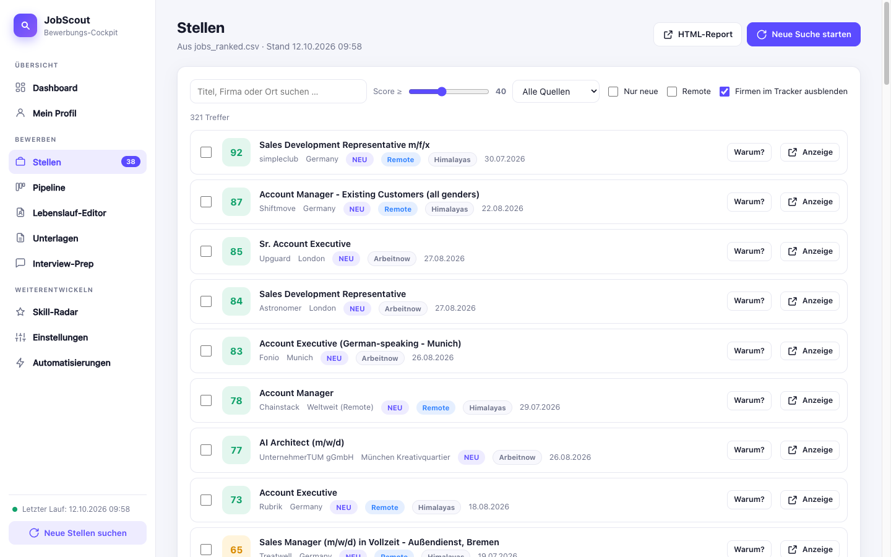

- Suche, Mindest-Score (Schieberegler), Filter „nur neue“, „nur Remote“,
  Quelle und „ohne Tracker-Einträge“
- Aufklappbare Scoring-Gründe je Stelle
- Merkliste: Stellen auswählen und gesammelt an den Bewerbungs-Workflow
  übergeben

### Pipeline

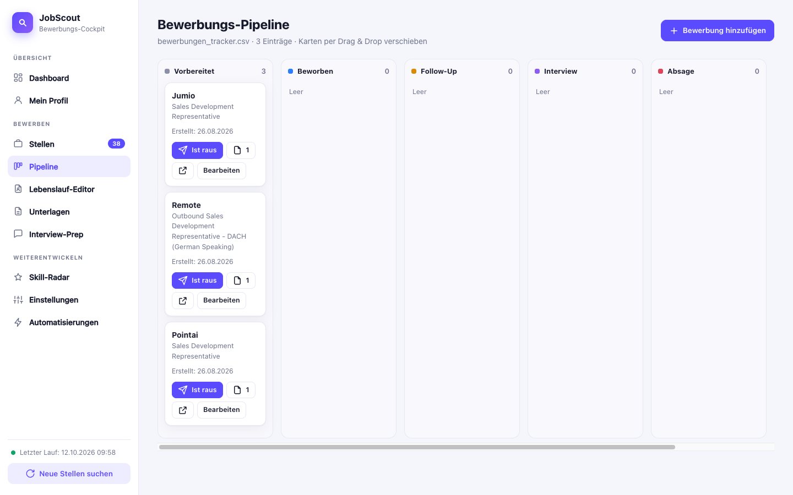

- Kanban für `bewerbungen_tracker.csv`: vorbereitet → beworben → Follow-up →
  Interview → Absage/Angebot
- Karten per Drag & Drop verschieben, bearbeiten, Unterlagen je Firma öffnen
- „Ist raus“ setzt das Bewerbungsdatum und das Follow-up-Datum
  (Standard 12 Tage, einstellbar); fällige Follow-ups werden markiert

### Mein Profil

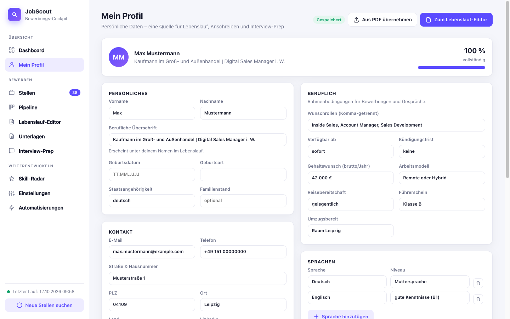

- Persönliches: Name, berufliche Überschrift, Geburtsdatum/-ort,
  Staatsangehörigkeit, Familienstand
- Kontakt: E-Mail, Telefon, Adresse, LinkedIn, XING, Website
- Beruflich: Wunschrollen, verfügbar ab, Kündigungsfrist, Gehaltswunsch,
  Arbeitsmodell, Reisebereitschaft, Führerschein, Umzugsbereitschaft
- Sprachen mit Niveau, Stärken, Interessen
- Kurzprofil (Vorlage für die CV-Zusammenfassung) und „Motivation & Notizen“
  für Anschreiben
- Vollständigkeits-Anzeige, automatisches Speichern, Import aus PDF
- **Eine Quelle für alles:** Bewerbungs- und Interview-Workflows lesen
  `profil.json` und `lebenslauf.json` automatisch mit

### Lebenslauf-Editor

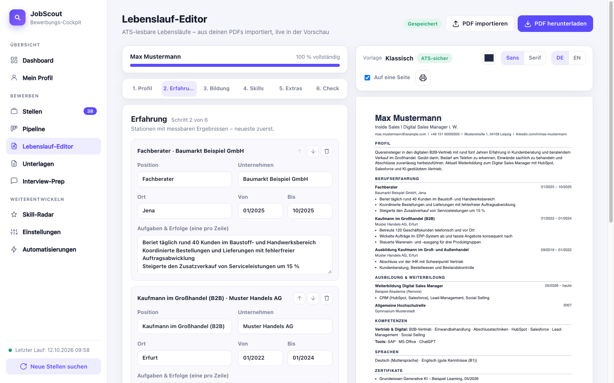

- 6 Schritte: Profil · Erfahrung · Bildung · Skills · Extras · Check
- Live-Vorschau auf A4, Vorlage „Klassisch“ – einspaltig, echter Text,
  Standard-Überschriften (ATS-sicher)
- Design: Akzentfarbe, Schrift (Sans/Serif), Überschriften Deutsch/Englisch,
  „Auf eine Seite“ (verkleinert automatisch, bis es passt)
- Stationen, Bildung, Skill-Gruppen, Zertifikate, Projekte und eigene
  Abschnitte hinzufügen, löschen, sortieren
- „Aus Skill-Profil übernehmen“ und „Kurzprofil aus dem Profil übernehmen“
- **PDF-Import:** PDFs hineinziehen oder aus dem Projektordner wählen;
  `pdftotext` liest, Claude strukturiert und repariert kaputte Zeichen
  (z. B. „KommunikaQonsstärke“ → „Kommunikationsstärke“). Wahlweise
  Lebenslauf ersetzen, Profil ergänzen oder überschreiben
- **PDF-Export** über Chrome headless nach
  `bewerbungen/Lebenslauf_<Name>[_<Firma>].pdf`; Fallback: Drucken

#### ATS-Check

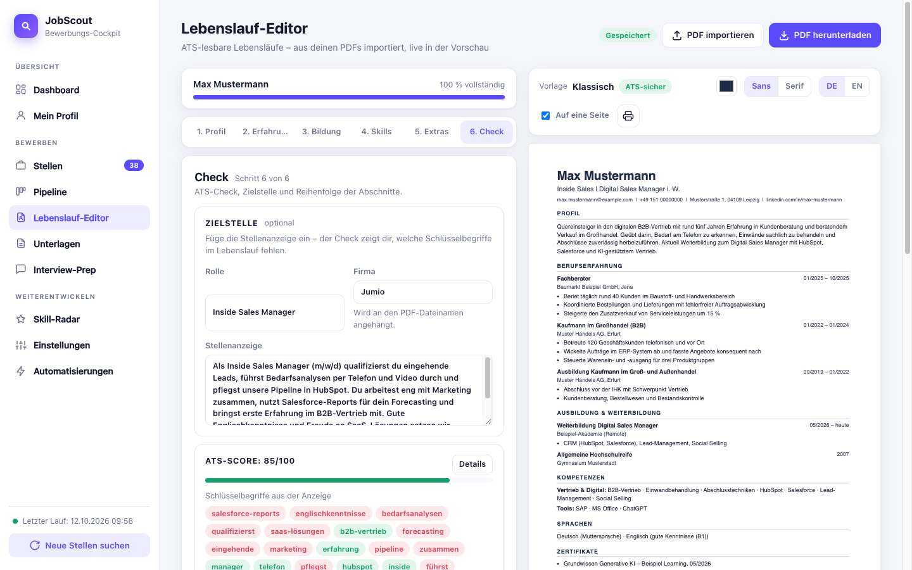

- Score 0–100 mit Einzelwertung: Kontaktdaten, Zusammenfassung,
  Berufserfahrung, aktive Formulierungen, messbare Erfolge, Skills, Bildung,
  keine Ich-Form, Länge
- **Passung zur Stelle:** Stellenanzeige einfügen → Schlüsselbegriffe werden
  extrahiert und grün/rot gegen den Lebenslauf geprüft
- Reihenfolge der Abschnitte frei sortierbar

### Unterlagen

Sechs Reiter:

1. **Stammdaten** – Vorschau des aktuellen Lebenslaufs, „Als PDF in
   Unterlagen speichern“ (mit Dateizusatz, z. B. Firma), gespeicherte
   Lebensläufe, Master-Dateien, Profil-Kurzkarte
2. **Zertifikate, Projekte, Eigene Abschnitte** – dieselben Daten wie im
   Lebenslauf-Editor unter „Extras“

   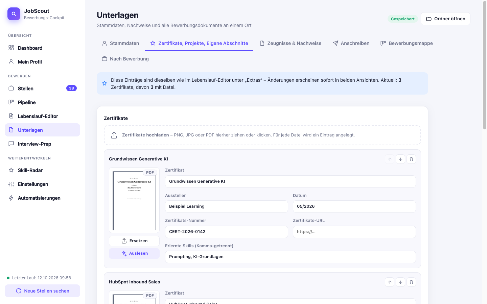

   - Upload von PNG, JPG oder PDF per Drag & Drop (mehrere auf einmal)
   - Miniaturansicht (PDF: erste Seite), Klick öffnet die Datei
   - Felder: Zertifikat, Aussteller, Datum, Zertifikats-Nummer,
     Zertifikats-URL, erlernte Skills
   - „Auslesen“: Claude füllt alle Felder aus der Datei
3. **Zeugnisse & Nachweise**

   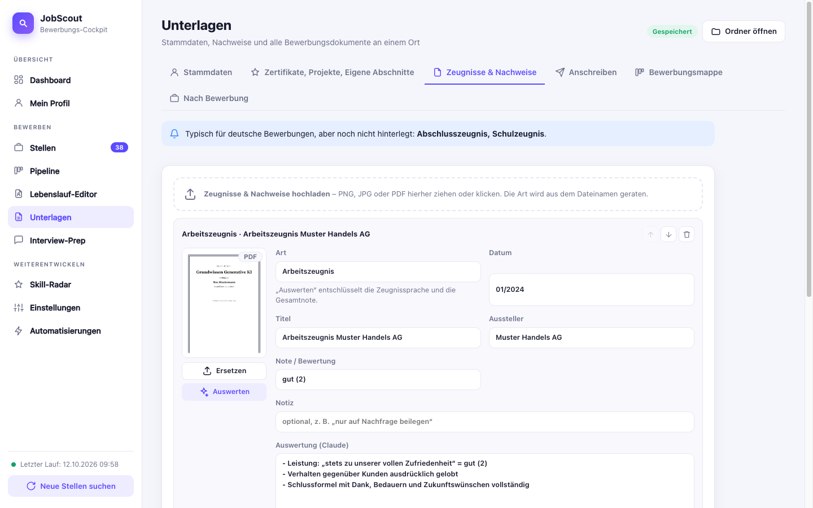

   - Arten: Arbeitszeugnis, Abschlusszeugnis, Schulzeugnis,
     Weiterbildungsnachweis, Referenz, Bewerbungsfoto, Arbeitsprobe, Sonstiges
     (wird aus dem Dateinamen geraten)
   - Felder: Titel, Aussteller, Datum, Note, Notiz; bei Referenzen Name,
     Position, Telefon und E-Mail der Kontaktperson
   - „Auswerten“: Claude entschlüsselt die Zeugnissprache, nennt die
     Gesamtnote und warnt vor versteckten negativen Formulierungen
   - Hinweis, welche typischen Unterlagen noch fehlen
4. **Anschreiben** – alle Anschreiben aus dem Workflow plus „Bausteine für
   Anschreiben“ (Motivation, Wechselgrund, No-Gos), die Claude mitliest
5. **Bewerbungsmappe**

   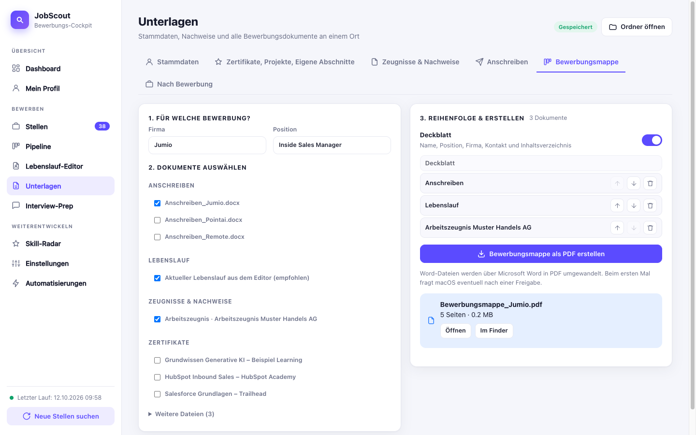

   - Firma wählen → passendes Anschreiben, aktueller Lebenslauf und Position
     (aus der Pipeline) werden vorausgewählt
   - Zeugnisse, Zertifikate und weitere Dateien anhaken, Reihenfolge ändern
   - Optionales Deckblatt mit Name, Position, Firma, Kontakt und
     Inhaltsverzeichnis
   - Ergebnis: `bewerbungen/Bewerbungsmappe_<Firma>.pdf` mit Seitenzahl,
     Dateigröße und Warnung ab 5 MB
   - DOCX wird über Microsoft Word umgewandelt (Fallback `textutil` + Chrome),
     Bilder werden auf A4 gesetzt, alles mit `pdfunite` zusammengeführt
6. **Nach Bewerbung** – alle Dokumente nach Firma gruppiert mit Pipeline-Status

### Interview-Prep
- Formular mit Firma, Position, Datum und Gesprächspartner
- Startet Claude Code im Terminal: Firmenrecherche, 10 wahrscheinliche
  Fragen mit Antwortgerüst, eigene Rückfragen, Checkliste
- Ergebnis als `Interview_Briefing_<Firma>.docx`

### Skill-Radar
- Wertet alle gesammelten Stellenbeschreibungen aus (ab Score 20)
- Nachfrage je Skill, Abgleich mit dem eigenen Status
  (vorhanden / Weiterbildung / Lücke), Trend über die Zeit
- Report direkt im Cockpit, Neuberechnung per Klick
- Kursempfehlungen aus der Skill-Gap-Analyse werden angezeigt

### Einstellungen

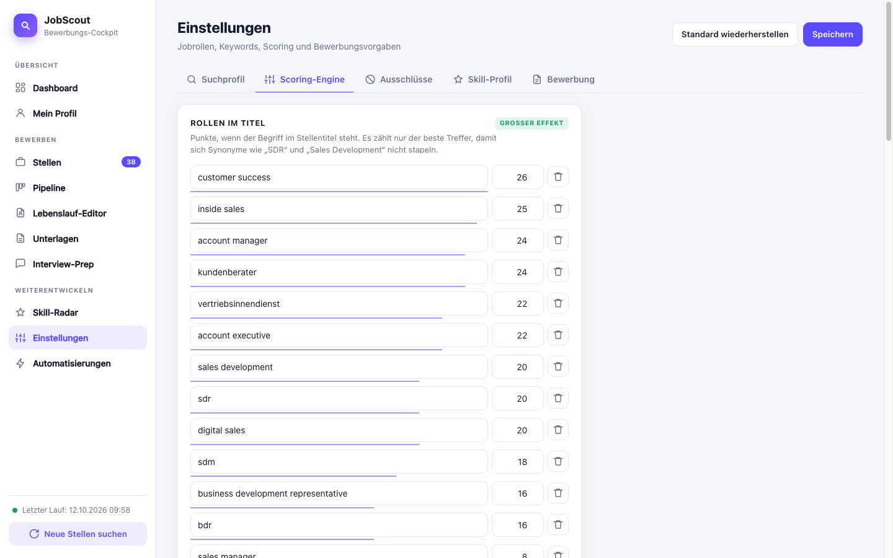

- **Suchprofil:** Suchbegriffe, Ort, Umkreis, bundesweite Remote-Suche,
  Quellen an/aus, Feintuning (BA-Details, Mitteilungs-Schwelle)
- **Scoring-Engine:** Gewichtungen für Rollen im Titel, Keywords in der
  Anzeige, Malus, Titel-Malus, Boni – mit **Live-Vorschau** der neuen
  Top-Treffer, Auf- und Absteiger; „Speichern & neu bewerten“ ohne neuen
  Suchlauf
- **Ausschlüsse:** Ausschluss-Begriffe und gesperrte Firmen
- **Skill-Profil** mit **Skill-Editor**

  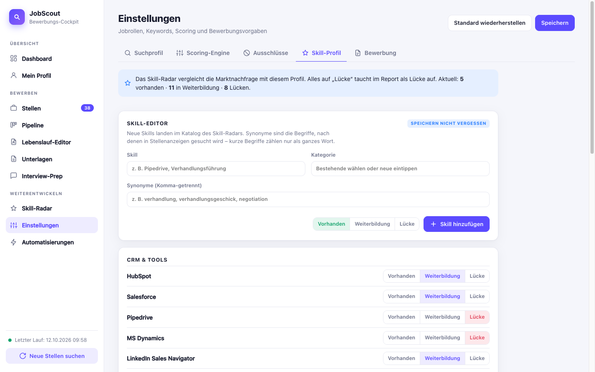

  - Status je Skill: vorhanden / Weiterbildung / Lücke
  - Eigene Skills mit Kategorie und Synonymen anlegen und entfernen –
    sie fließen sofort ins Skill-Radar ein
- **Bewerbung:** Tonfall (wie die Anzeige / förmlich / locker), Sprache,
  eigene Anweisungen, Kurzliste ab Score, maximale Stellen, Follow-up-Tage
- „Standard wiederherstellen“ (alte Datei bleibt als `.bak` erhalten)

### Automatisierungen
- Alle Bausteine auf einer Seite startbar: Job-Scraping, Skill-Radar,
  Bewerbungs-Workflow, Skill-Gap-Analyse, Interview-Prep
- Live-Status und Log-Ausgabe laufender Aufgaben

---

## Kommandozeile & Automatisierung

| Befehl | Was passiert |
|---|---|
| `python3 job_scout.py` | Suchlauf über alle aktiven Quellen, Scoring, `jobs_report.html` + `jobs_ranked.csv` |
| `python3 skill_radar.py` | Skill-Analyse → `skill_report.html` |
| `./run_job_scout.sh` | Suchlauf mit Logging nach `lauf.log` |
| `./run_bewerbungs_workflow.sh` | Bewerbungs-Workflow mit Claude Code |
| `./run_skill_gap_analyse.sh` | Skill-Gap-Analyse + Kurssuche mit Claude Code |
| `run_interview_prep.command` | Interview-Prep per Doppelklick |

- **LinkedIn-Brücke** (`linkedin_bridge.py`): Claude ruft den LinkedIn-MCP-Server
  auf, die Treffer landen in `linkedin_treffer.json` und fließen beim nächsten
  Lauf ein
- **Zeitgesteuerte Läufe:** Vorlagen für macOS-launchd im Ordner
  `launchagents-archiv/` (Doku in `cowork_prompts.md`); alternativ per cron:

  ```bash
  0 8 * * * cd /pfad/zu/JobScout && /usr/bin/python3 job_scout.py >> lauf.log 2>&1
  ```
- **Claude-Skills** zum Bewerbungsprozess liegen in `skills/` (siehe
  `skills/README.md`)

---

## Dateien & Datenschutz

| Datei / Ordner | Inhalt | Im Repo? |
|---|---|---|
| `einstellungen.json` | alle Einstellungen aus dem Cockpit, inkl. eigener Skills | ja |
| `profil.json` | persönliche Daten | **nein** (`.gitignore`) |
| `lebenslauf.json` | Lebenslauf-Inhalte | **nein** |
| `nachweise.json` | Zeugnisse & Nachweise | **nein** |
| `unterlagen/` | hochgeladene Zertifikate, Zeugnisse, Miniaturen | **nein** |
| `bewerbungen/` | Lebensläufe, Anschreiben, Bewerbungsmappen | teilweise |
| `bewerbungen_tracker.csv` | Bewerbungs-Pipeline | ja |
| `jobs_ranked.csv`, `jobs_gesehen.db`, Reports | Ergebnisse der Suchläufe | nein |

Die Standardwerte für Profil und Scoring stehen am Anfang von `job_scout.py`
(`PROFIL`, `SCORE_REGELN`) und `skill_radar.py` (`SKILL_KATALOG`,
`MEIN_STATUS`). `einstellungen.json` überschreibt sie – auch bei Läufen ohne
Cockpit.

JobScout nutzt für die Stellensuche ausschließlich offizielle, öffentliche
APIs – kein Scraping. Alle Daten bleiben lokal; Claude wird nur über die
lokale Claude-Code-CLI aufgerufen.

---

## Architektur & Tech-Stack

```
job_scout.py        Fetcher (BA, Adzuna, Arbeitnow, Himalayas, LinkedIn-Datei) → Scoring → Report/CSV/SQLite
skill_radar.py      Skill-Katalog + Status → Nachfrage-Analyse → skill_report.html
jobscout_app.py     HTTP-Server (Standardbibliothek) + API für das Cockpit
cv_editor.py        Profil, Lebenslauf, PDF-Import/-Export, Zertifikats-Uploads
unterlagen.py       Zeugnisse & Nachweise, Bewerbungsmappe
app/                Frontend: index.html, app.css, app.js, einstellungen.js, lebenslauf.js
```

**Tech-Stack:** Python 3.9+ (nur Standardbibliothek + `requests` für den
Scraper) · SQLite · Vanilla JavaScript ohne Build-Schritt · Poppler
(`pdftotext`, `pdftoppm`, `pdfunite`) · Chrome headless · Claude Code CLI
